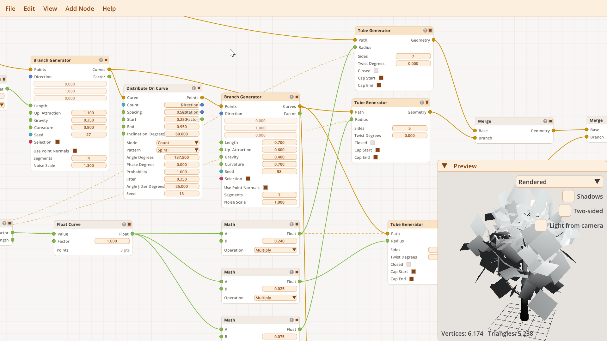
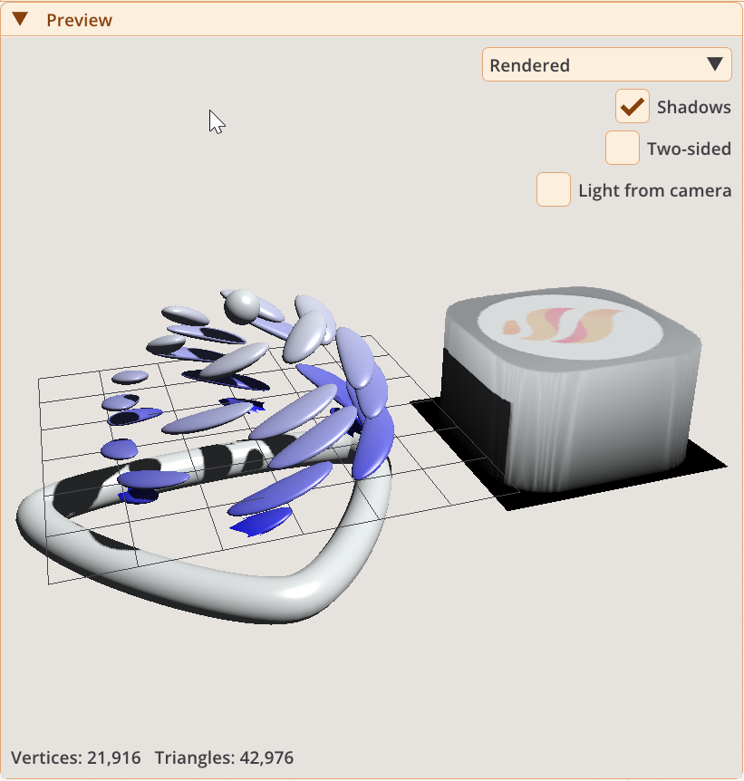
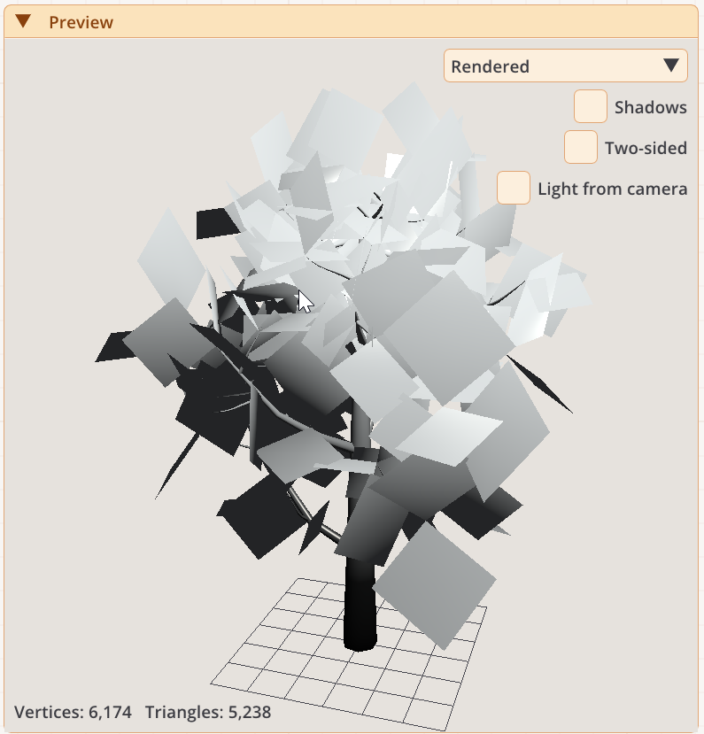
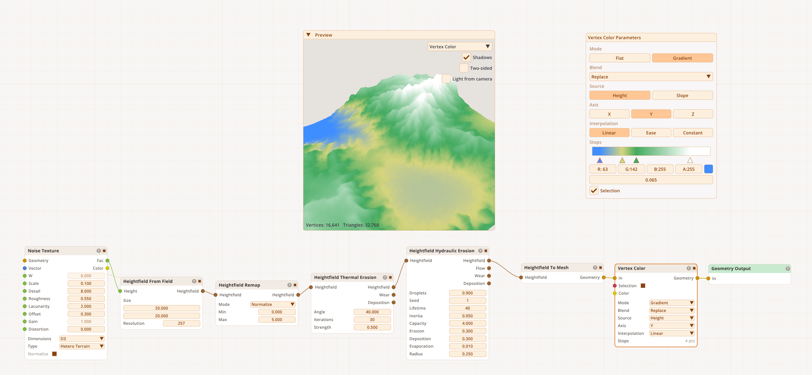

# Nodra

**Procedural 3D modeling with a visual node editor.**

Nodra is a standalone desktop app for creating procedural meshes, terrains, and vegetation. Connect generators and modifiers, adjust their parameters, and inspect the result in a live 3D preview. Export your geometry for use in a game engine, renderer, or 3D printing workflow.

[Official website](https://nodra3d.com) · [Download releases](https://github.com/OlegDzhuraev/Nodra.Releases/releases) · [Unity plugin](https://github.com/OlegDzhuraev/nodra)

*Procedural vegetation graph with a live 3D preview.*

## What you can create

- **Procedural models:** start with primitives, curves, and tubes; combine them with extrusion, beveling, subdivision, booleans, and deformation.
- **Terrains:** build heightfields with noise and landform shapes, apply thermal or hydraulic erosion, and generate height, slope, curvature, and flow masks.
- **Vegetation and scattered geometry:** grow branches and leaves, distribute points along curves or across surfaces, and place instances with controlled rotation and scale.
- **Surface detail:** use procedural textures, vertex colors, UV projection and unwrapping, and per-point fields to control your geometry.

## Example previews

Screenshots of Nodra's Preview window with `demo.ndr` and `tree_branches.ndr` open.

| Procedural tube (`demo.ndr`) | Tree preview (`tree_branches.ndr`) |
| --- | --- |
|  |  |

### Heightfield terrain

Generate a heightfield from procedural noise, shape it with thermal and hydraulic erosion, and convert it to a mesh. A height-based vertex color gradient highlights lowlands, slopes, and mountain peaks in the live preview.

*Procedural terrain with thermal and hydraulic erosion and a height-based color gradient.*

## Work visually

Build reusable node graphs, inspect intermediate results with Viewer nodes, and keep the final output separate from the branch you are previewing. The editor includes node search, parameter editing, undo/redo, copy/paste, and light and dark themes.

Save your work as `.ndr` graphs and reuse saved graphs as subgraphs. Imported meshes and textures are embedded when saving, so those assets travel with the graph.

For a larger view, open the separate Renderer window from **File > Open Renderer**. It follows changes in the editor and supports shadows, SSAO, bloom, and PNG captures.

## Import and export

| Content | Supported formats |
| --- | --- |
| Mesh import | Wavefront OBJ |
| Mesh export | glTF 2.0, OBJ, binary FBX, binary STL |
| Terrain export | 16-bit PNG or RAW heightmaps, PNG masks, normal maps, RGBA splatmaps |
| Texture export | PNG |
| Editable graphs | `.ndr` |

## Download and run

Open the [Releases page](https://github.com/OlegDzhuraev/Nodra.Releases/releases) and choose the standalone app package for your platform:

| Platform | Package |
| --- | --- |
| Windows x64 | `Nodra-<version>-win-x64.zip` — extract the entire archive and run `Nodra.Standalone.exe`. |
| macOS Apple Silicon | `Nodra-<version>.dmg` — open the disk image and copy `Nodra.app` to Applications. |
| Linux x64 | `Nodra-<version>-linux-x64.tar.gz` — extract the archive and run `Nodra.Standalone`. |

Keep the accompanying libraries and resource folders with the executable. The standalone packages use NativeAOT and do not require a separate .NET runtime installation. See each release's notes for the files included in that release.

## About this repository

This repository distributes releases of the **Nodra standalone app** and **Nodra Core**, the geometry library for integration with game and rendering engines. Core packages are named `Nodra_Core-<version>-<platform>`; choose a standalone app package if you want the visual editor.

Source code is not included in this repository. For the Unity plugin's source code and integration information, visit [OlegDzhuraev/nodra](https://github.com/OlegDzhuraev/nodra).
